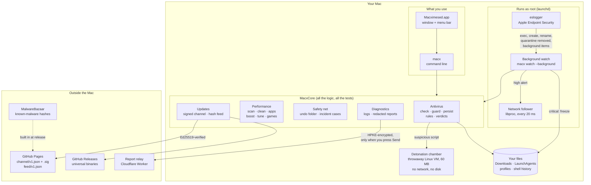
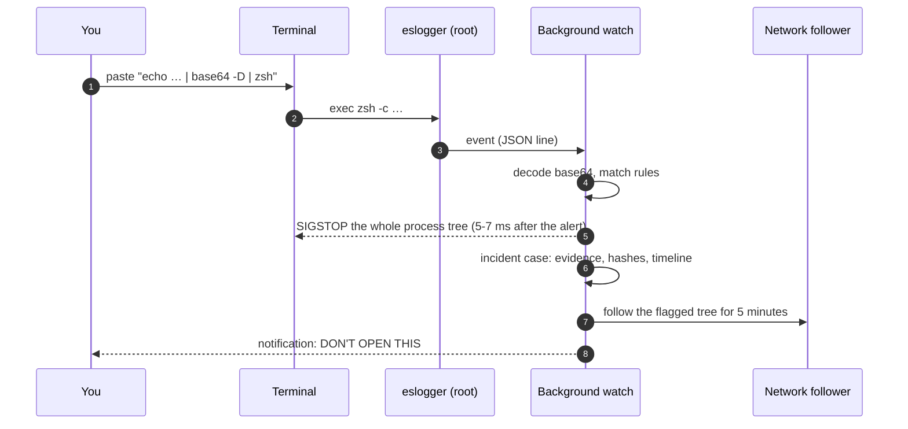

# Roadmap

Where Macximesed is going, and how the pieces fit together. [STATUS.md](STATUS.md) is the detailed job list and [CHANGELOG.md](CHANGELOG.md) is what has shipped.

## How it fits together

One Swift package and one signed program. `macx` is the command-line tool, the Mac app and the root background watch, depending on how it's started. Everything that decides anything lives in **MacxCore**, which has the tests. The parts outside the Mac are all static files or a tiny relay, and every file that can change what the Mac does is signed.

### The rules the design follows
- **Nothing runs on trust from a name or a path.** Owners come from Spotlight and code signatures, a removed quarantine flag is judged by what Gatekeeper says about the file, and `/opt/homebrew` is never trusted because you can write to it.
- **Anything the root watch reads from your folder is checked again.** The malware feed only counts if the signed channel saved next to it verifies with the release key.
- **Every change can be undone.** Cleaning moves files to the undo folder; only *Empty undo folder*, `undo empty` and `undo purge` delete.
- **Every byte that can change your Mac is signed.** Updates, the hash feed and the security floor come from one signed file with a sequence number and an expiry. Beta builds get their own key, which stable never trusts.
- **Nothing leaves the Mac without a click.** Reports are redacted, shown in full and encrypted before they're sent.
- **macOS stays stock.** SIP, Gatekeeper, XProtect, FileVault and the firewall are never touched.

### How an attack is caught

On the last runtime evaluation (macOS 27.0.1, M3) all 7 simulated steps were alerted in 31-257 ms and frozen 5-6 ms after the alert.

## Roadmap

### Done
- **Antivirus (0.2.0):** file checks, the paste-to-shell guard, persistence scans with baseline and diff, the live watch with freezing, network following, incident cases, the signed update channel with a security floor, the signed hash feed.
- **The Mac app (0.3.0):** window and menu bar, first-run setup, the background watch as a launchd daemon, the light detonation chamber, Boost, `top`, `tune`, games, the Downloads watch with automatic quarantine, Intel support.

### Now (on `dev`, not released yet)
- **Fewer false alarms:** a removed quarantine flag on software Apple notarized is low (it was high for every `brew upgrade`).
- **Fixes in the background watch:** it no longer grows in memory (114 MB after three hours, now about 20 MB), and it only trusts a signed malware feed, which it re-reads every minute.
- **Configuration profiles** checked against a real installed profile; installed browser policies are now caught.
- **Diagnostics:** `-v` logs, redacted bug and crash reports, encrypted sending through the relay.
- **Beta channel:** a build of every change, named by its commit, with its own signing key.
- **More of what eslogger sees:** XProtect detections, privacy permissions granted, profiles installed, account and admin changes, *Open Anyway*, code injection, screen sharing and SSH logins.

### Next
1. **Independent testing:** run Red Canary's [Atomic Red Team](https://github.com/redcanaryco/atomic-red-team) macOS tests against the watch, so the attacks aren't only ones we wrote ourselves, and publish the results.
2. **Beta workflows:** build and sign every green push to `dev` automatically.
3. **A real malware feed:** MalwareBazaar's macOS stealer tags in the feed at each release.
4. **Chamber, phase 2:** a fake internet to see what a sample would upload, skipped sleeps, `.pkg` install scripts, Python and Perl.
5. **Sharper checks:** known-bad domains, where a download came from, disguised file types.

### Later
- **Risky cleanup tier:** triple confirmation and an undo script.
- **Extreme tier:** deleting apps on the sealed system volume, only after you turn SIP off in Recovery yourself. Off by default, last on the list.
- **macOS 27.3:** re-check Full Disk Access, the setup steps and the Metal HUD when Apple's new folder-only grants arrive.

### Won't do
- **Blocking before something runs.** That needs Apple's Endpoint Security entitlement; Macximesed notices and stops things right after they start instead.
- **A "remade" macOS.** macOS is closed and its images can't be redistributed. Macximesed is stock macOS plus one tuned profile.
- **Anything that turns off a macOS protection for you.**
